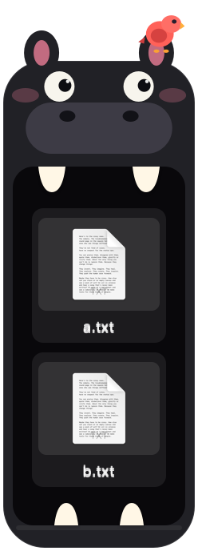

# HippoShelf

ファイルをカバの口にポイ。

macOS 用の一時的な置き場です。ファイルをドラッグし始めると、画面の右端からカバがすっと現れて口を開けます。口の中に落とせば、しばらく預かってくれます。空になればまた隠れます。

<p align="center">
  <a href="README.md">简体中文</a> · <a href="README.en.md">English</a> · <a href="README.es.md">Español</a> · 日本語 · <a href="README.ko.md">한국어</a> · <a href="LICENSE">MIT</a>
</p>

<p align="center">
  
  &nbsp;&nbsp;
  
</p>

## なぜ

スクリーンショットや素材、送る予定のファイルがデスクトップに散らかります。カバはドラッグ中だけ現れるので、邪魔になりません。

## 機能

- **ドラッグで出現**：ファイルをドラッグし始めると右端からスライドイン
- **口で受け止める**：カバの顔の上で離すと収納。重複ファイルは自動でスキップ
- **一時的な置き場**：1行に1ファイル、サムネイルとファイル名。ファイルが増えると口が縦に伸びる（スクロールなし）。空になると自動で隠れる
- **取り出す**：外へドラッグするとコピーされる（元ファイルはそのまま）。クリックで選択、スペースでクイックルック、ダブルクリックで開く
- **複数選択**：⌘クリック、⇧クリック、空白をドラッグして範囲選択。まとめて取り出せる
- **2つのスキン**：カートゥーン（黒いカバの顔）／シンプル（半透明ガラス）。メニューバーから切り替え
- **好きな場所へ**：上部をドラッグして移動。次に表示したときも同じ位置
- **メニューバー**：表示/隠す（⌘S）、空にする、スキン、終了
- **小さな動き**：まばたき、耳の揺れ、マウスを追う瞳（カートゥーンスキン）

## 動作環境

macOS 13 以降、Intel / Apple Silicon 対応（ユニバーサルバイナリ）。

## ビルド

Xcode Command Line Tools が必要です（`xcode-select --install`）：

```bash
git clone https://github.com/wunankun/HippoShelf.git
cd HippoShelf
./build.sh
open HippoShelf.app
```

`build.sh` は arm64 と x86_64 を `swiftc` でコンパイルし、`lipo` でユニバーサルバイナリにまとめます。

## 使い方

`HippoShelf.app` を「アプリケーション」へ：

- 初回起動：アプリを右クリック →「開く」→ もう一度「開く」（ローカル署名のため）
- 「壊れているため開けません」と出たら：`xattr -dr com.apple.quarantine /Applications/HippoShelf.app`
- Dock にアイコンは出ません。メニューバーの小さなカバだけです
- 初回にデスクトップ／書類／ダウンロードへのアクセスを求められたら許可してください
- ログイン時に起動：システム設定 → 一般 → ログイン項目

## 注意

- 置き場はファイルのパスのみを保持します。移動・コピー・アップロードは一切しません。アプリを終了するとリストは消えます
- ファイルが増えると口は伸び続けます（スクロールなし）。画面に収まらないときは空にしてください
- 外へドラッグするとコピーされます。元ファイルは削除されません

## ライセンス

[MIT](LICENSE) © 2026 wunankun

アプリアイコンは AI ツールで生成し、作者が加工しました。
